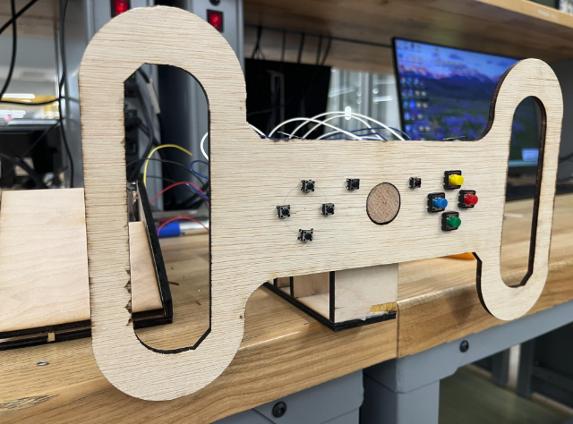
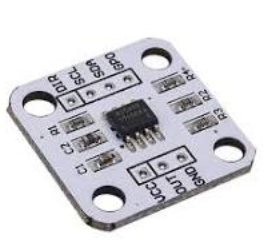
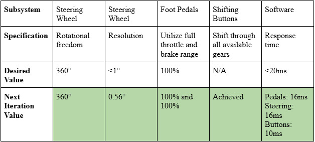

# USB Steering Wheel
Retroactive senior capstone Github repository.

## Problem Statement
Racing simulators are used by hobbyists and professionals alike, but for someone new to the sport, there are very few budget-friendly, competitive hardware options. This project aimed to create a budget-friendly USB steering wheel by cutting luxury materials while maintaining competitive viability through careful component selection.

## Demo

This image shows the physical wheel, along with its buttons. The button layout is modeled after other game controllers, and is useful for navigating menus or performing in-game actions.

## Components

The [AS5600 encoder](https://www.walmart.com/ip/AS5600-Magnetic-Encoder-Magnetic-Induction-Angle-Measurement-Sensor-Module-12bit-High-Precision-with-Magnet-1set/17412909036?wmlspartner=wlpa&selectedSellerId=102895224&selectedOfferId=1608B281CFEA353BA20AE6E146EE366B&conditionGroupCode=1&wmlspartner=wlpa&cn=FY25-ENTP-PMAX_cnv_dps_dsn_dis_ad_entp_e_n&gclsrc=aw.ds&adid=222222222971608B281CFEA353BA20AE6E146EE366B_6736816237_21407473164&wl0=&wl1=g&wl2=c&wl3=&wl4=&wl5=9005779&wl6=&wl7=&wl8=&wl9=pla&wl10=5622660921&wl11=online&wl12=1608B281CFEA353BA20AE6E146EE366B&veh=sem&gad_source=4&gad_campaignid=21690411341&gbraid=0AAAAADmfBIo-iz8zbVffQWbq5N2Qbk0VN&gclid=Cj0KCQiA5NXXBhDEARIsABAJhdL9PlJJ-Of3f3Q8vfnFPJO5o-V9qmlSwr3zTatpCiHNQi1trwiHZMoaAlb3EALw_wcB) used, pictured above, was selected for a few main reasons. It offers 12-bit precision, analog or $I^{2}C$ communication, works with a 3.3V input, and comes at an incredibly cheap price. Alternative options proved to be more expensive and more complicated to set up and use.

The buttons used varied in size and color, but otherwise were just standard buttons. They are readily available on Digikey or any other electronics retailer for a cheap price.

The linear potentiometers used for the project were selected based on size and cost. Size is important since they are being used for the pedals, and thus must fit within the pedal's range of motion. Specifically, 6cm linear potentiometers at the lowest cost proved to be the optimal choice.

## Implementation

The top-level design outlines the flow of information between subsystems and shows how this forms the overall system. The steering wheel, buttons, and pedals feed into the microcontroller which communicates back and forth with the simulator software, and finally the data received from the simulator software is used to control the force feedback motor.

The above graph shows the results of testing the electrical characteristics of the linear potentiometers used in the pedals. The graph shown on the left is the expected curve given by the datasheet. Both potentiometers were tested by moving the shaft a measured distance, then measuring the input and output voltages produced. Since both potentiometers are more linear than the datasheet expects them to be, the firmware is easier to implement. This is because the conversion from analog potentiometer reading to simulator software input can be mapped linearly.

Similarly, this graph shows the linearity testing results of the magnetic encoder. This graph was created by rotating the magnetic encoder and measuring the angle of rotation, then using the serial monitor to record the measured ADC value. Clearly, there is a linear relationship between the rotation of the encoder and the ADC output.

## Results

The results table shown above is based on the specifications defined for the project. These were benchmarks that were important to meet in order for the system to be competitively viable. The steering wheel should be able to rotate a full 360 degrees while having precision within 1 degree, the pedals should be able to utilize the full brake and throttle range in the simulator software, there should be enough buttons to navigate menus and shift through all gears, and the response time should be under 20ms to put the device in line with other game controllers.

The values listed are the values achieved by the final design of the project. The response time was calculated by recording a user turning the wheel while the screen is visible in the shot. Then by analyzing the footage frame-by-frame, the time it took for the user's input to appear on screen could be measured.

## Future Work

There is quite a bit that could be improved in the next iteration of this project. Most importantly, the device should run from a PCB to eliminate the need for wires spanning across the device, as seen in the demo picture. This change alone would clean up the final project aesthetically, make it easier to use, and make it more durable.

Additionally, the base that holds up the wheel needs to either be heavier or attach to the desk. A problem that emerged during testing was that the wheel would not remain stationary if the user attempted a sudden movement. To solve this, making the wheel heavier could help to keep it in place on the desk. However the more consistent solution would be adding a clip or clamp that securely attaches the wheel to the desk.

Finally, it would be beneficial to test more materials to fabricate the final build from. Wood worked because it was cheap and durable, but it certainly feels odd to use a wooden wheel. Using plastic for the structure of the device along with rubber grips would go a long way in creating a more ergonomic and aesthetic device. If this solution were to be brought to market, it is also likely that mass production would be easier when using plastic compared to wood.
